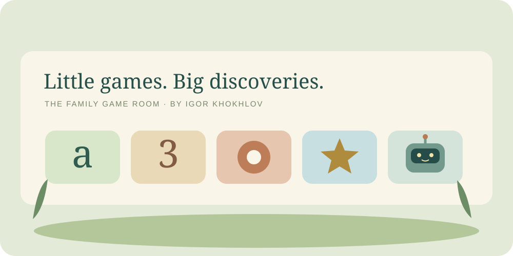
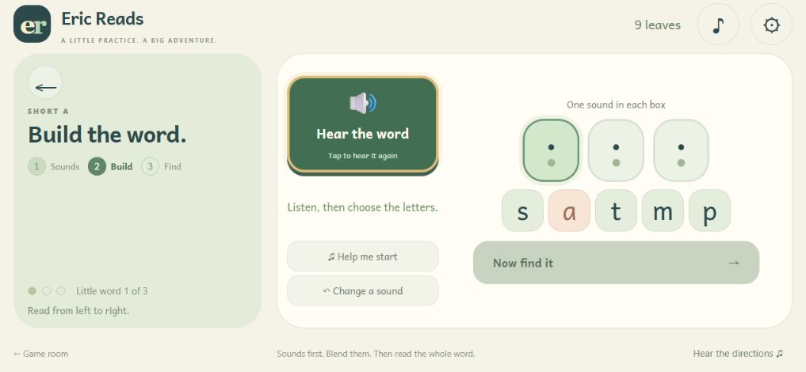
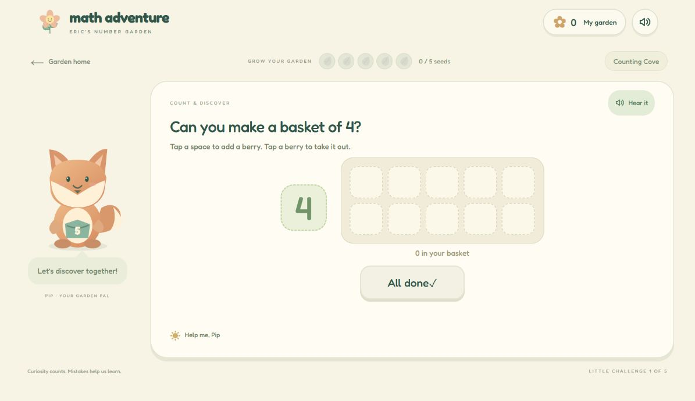
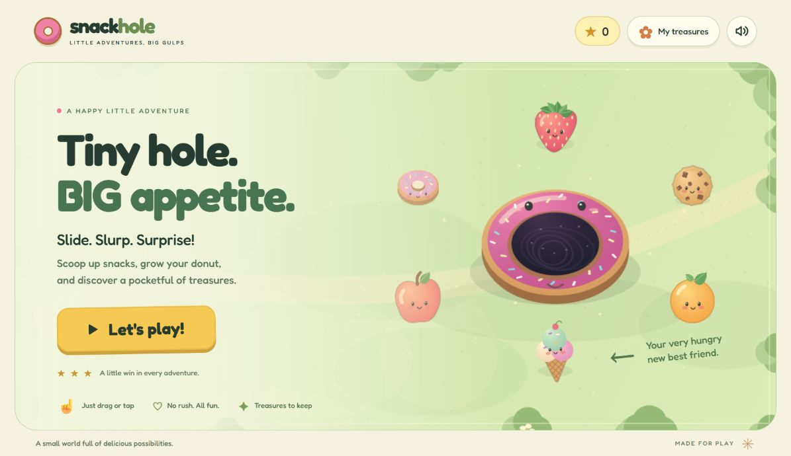
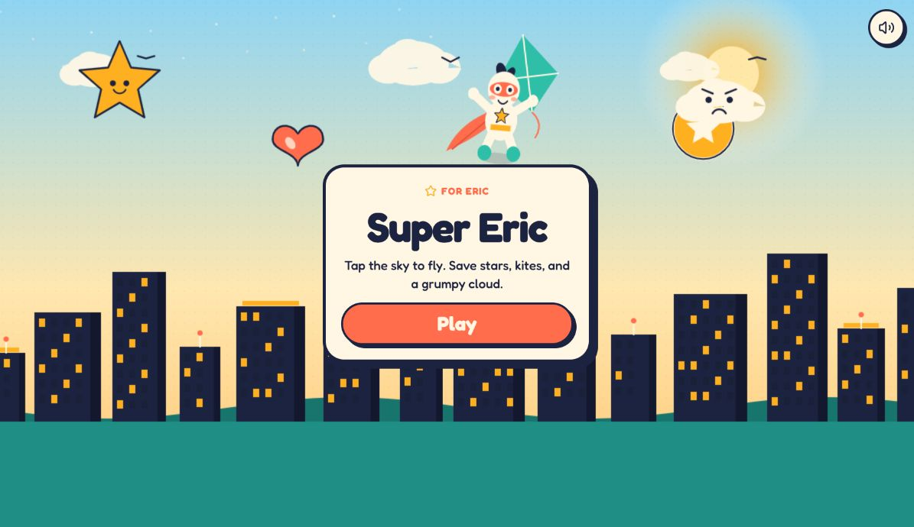

<p align="center"></p>

<p align="center">
<a href="https://github.com/i-xoxol/family-game-room/actions/workflows/checks.yml"></a>


<a href="LICENSE"></a>
</p>

<p align="center"><strong>Five small browser adventures, built for my son and shared for curious families and builders.</strong><br>Read a word. Grow a number. Rescue a friend. Ask a robot.</p>

<p align="center"><a href="https://i-xoxol.github.io/family-game-room/">Visit the game room</a> · <a href="#the-games">The games</a> · <a href="#run-it-yourself">Run it yourself</a> · <a href="docs/architecture.md">Architecture</a></p>

## Why I built this

I wanted personal, gentle games that my young son could play on the iPad we already owned. Reading instructions should be spoken. A small finger should be able to find the next step. Pictures should support the activity in front of him.

This collection grew through real feedback: a blending slider that completed too early, a word prompt that was hard to replay, or a browser toolbar that hid the next button. Those details shape the games as much as the artwork.

I use AI coding tools to develop and refine these projects. The source, prepared assets, checks and design tradeoffs are here so others can understand and adapt them.

## The games

| Game | What the player does | Stack | Try it |
|---|---|---|---|
| **[Reading Garden](games/reading-garden)** | Hear sounds, blend, build a heard word, read short sentences and follow three stories | JavaScript modules, Web Audio, SVG; 266 prepared clips | [Play](https://i-xoxol.github.io/family-game-room/play/reading-garden/) |
| **[Number Garden](games/number-garden)** | Count, match, compare and build little numbers | JavaScript, SVG, prepared narration, esbuild | [Play](https://i-xoxol.github.io/family-game-room/play/number-garden/) |
| **[Snack Hole](games/snack-hole)** | Move a donut, scoop snacks, grow and collect treasures | Canvas 2D, Web Audio, deterministic game logic | [Play](https://i-xoxol.github.io/family-game-room/play/snack-hole/) |
| **[Super Eric](games/super-eric)** | Fly through friendly skies and help little friends | React, TypeScript, Canvas, TanStack Start | [Play](https://games.khokhlov.org/games/super-eric/) |
| **[Робі](https://github.com/i-xoxol/robi-playroom)** | Talk in Ukrainian, ask questions and play prepared games | Node.js, Realtime voice, SVG robot, parent controls | [Project page](https://i-xoxol.github.io/robi-playroom/) |

Robi remains in its existing public repository, pinned here as the `games/robi` Git submodule. This keeps one authoritative history for the voice backend.

## See the games

### Reading Garden



The spelling target plays when the build step opens. A large speaker button stays beside the letters. A short landscape viewport still shows hints and the next-step button.

### Number Garden and Snack Hole

| Number Garden | Snack Hole |
|---|---|
|  |  |

### Super Eric and Robi

| Super Eric | Робі |
|---|---|
|  |  |

Screenshots use prepared content and test progress. They contain no child speech, private family profiles or credentials.

## Run it yourself

Use [Node.js](https://nodejs.org/) 22.13 or newer. The framework game is also checked with Node 22 in CI.

```bash
git clone --recurse-submodules https://github.com/i-xoxol/family-game-room.git
cd family-game-room
npm run setup
npm test
npm run build
npm run dev
```

Open **http://127.0.0.1:18102/**. The build produces the portfolio and three static demos in `dist/`. No API key is required. If you cloned without submodules, run `git submodule update --init --recursive` first.

Super Eric runs separately:

```bash
cd games/super-eric
npm run dev
```

Open **http://127.0.0.1:18104/**. See its [README](games/super-eric/README.md) for production builds and test scope.

For a private Robi instance, follow the [Robi setup guide](https://github.com/i-xoxol/robi-playroom/blob/main/docs/getting-started.md). Paid voice requires your own provider configuration and parent-controlled server.

## Design choices

- **Prepared audio:** reading and math clips ship as files. Playback does not call a TTS or model API.
- **Clear phonics practice:** sounds, blending, spelling and connected text have distinct steps. Read the [teaching rationale and sources](games/reading-garden/docs/research.md).
- **Touch and short screens:** large controls, single-activity layouts and tests for reduced landscape height. Browser simulation complements physical-device feedback; it does not certify every iPad/Safari version.
- **Local progress:** the static demos save to browser storage. No central account or analytics service is used.
- **Separate voice service:** Robi handles server-side secrets, budget, authentication and memory in its own project.

## Checks and deployment

`npm test` runs the static-game regressions, reader checks, Robi tests and byte-range server tests. The [Checks workflow](.github/workflows/checks.yml) also typechecks, tests and builds Super Eric. The publication check rejects private operational files and common credential patterns.

The [Pages workflow](.github/workflows/pages.yml) deploys `dist/` through GitHub Actions. It publishes three static demos, the collection page and five game overviews. Super Eric uses its existing server deployment; Robi’s overview points to its separate public project page.

See [architecture and hosting](docs/architecture.md), [verification notes](docs/verification.md) and [third-party notices](THIRD_PARTY_NOTICES.md).

## Privacy and practical limits

Public source excludes deployment credentials, private family profiles, child recordings and server databases. The static demos have no microphone or model access. Generated narration is synthetic; phoneme samples should still be reviewed by a fluent adult.

These are supervised family projects. Reading Garden is original supplementary practice, not an official school product or a clinically validated intervention. Rich story narration is listening material; the simple child-reading turns are separate. Robi’s AI responses need adult oversight and applicable provider approval.

## License and provenance

Original project code is [MIT licensed](LICENSE). Fonts, dependencies, generated media and platform material have separate terms; see [THIRD_PARTY_NOTICES.md](THIRD_PARTY_NOTICES.md). Super Eric was originally made with Grok App Builder and retains its platform assets and scaffold. Historical builder instructions are archived as provenance, with no private platform logs or account configuration.
