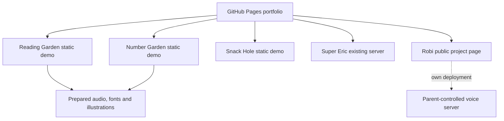

# Architecture and hosting

The collection is a small source monorepo with one pinned public submodule.

| Directory | Purpose |
|---|---|
| `games/reading-garden` | Static modules, teaching rationale, fixed media, generation tools and tests |
| `games/number-garden` | Garden UI, numeric challenge generator, narration and build |
| `games/snack-hole` | Canvas renderer, isolated deterministic game core and build |
| `games/super-eric` | Full React/TanStack application and original builder scaffold |
| `games/robi` | Pinned Git submodule of the separate voice project |
| `site` | Handwritten HTML/CSS portfolio, overview pages and actual screenshots |
| `tools` | Build orchestration, local static server, publication checks |

## Static build

`npm run build` builds Number Garden and Snack Hole, copies the reader’s prepared files, and writes the site into `dist/`. The game-room links and reader manifest are made relative so the demos work below GitHub Pages’ repository path. The build only replaces the verified repository-local `dist` directory.

The local server binds to loopback and serves `dist/` with MIME types and byte-range support. No directory listing or source files are exposed. GitHub Pages provides the production static hosting.

## Super Eric

Super Eric is a server-rendered TanStack Start application. Its production build creates Nitro/Vercel output. Run it separately rather than treating that server bundle as static files. The collection uses the already-public game URL for play.

The export includes a nonsecret build flag disabling the unused account feature. Database migrations skip when no database URL is configured. Keep the original platform credits and review the retained scaffold before adapting its server/auth features.

## Robi

Robi’s provider keys, parental settings, child context and learned memories belong to an independently configured server. They are absent from this repository and the Pages build. The submodule pins a reviewed public revision; update it intentionally and rerun its checks.

## Audio lifecycle

Reading and math use previously generated speech files. Playback fetches local assets and queues decoded audio; new reading content requires an explicit preparation pass. Snack Hole and Super Eric create game sounds locally. The static games neither record a microphone nor contact a synthesis API during play.
